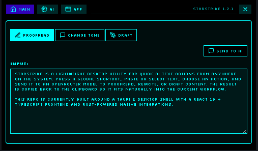

# Starstrike

Starstrike is a lightweight desktop utility for quick AI text actions from anywhere on the system. Press a global shortcut, paste or select text, choose an action, and send it to an OpenRouter model to proofread, rewrite, or draft content. The result is copied back to the clipboard so it fits naturally into the current workflow.

This repo is currently built around a Tauri 2 desktop shell with a React 19 + TypeScript frontend and Rust-powered native integrations.



## Usage after you set your shortcut

- copy text
- shortcut opens window
- hit enter key (window closes when set in settings)

## Stack

- Tauri 2 desktop app shell
- React 19 + TypeScript
- Vite 7 for frontend dev/build
- Rust + Tokio + reqwest for native app logic and API calls
- OpenRouter as the model backend
- Tauri plugins:
  - `tauri-plugin-global-shortcut`
  - `tauri-plugin-clipboard-manager`
  - `tauri-plugin-store`
  - `tauri-plugin-autostart`
  - `tauri-plugin-opener`
- Custom CSS theme system in the frontend, not a CSS framework like Tailwind

## Features

- Global system-wide shortcut to show the overlay
- Minimal always-on-top overlay window for fast text workflows
- Actions for proofreading, tone changes, and drafting content
- Clipboard input and selected-text handling
- Model selection and API-key management in app settings
- Persistent settings stored through the Tauri store
- Autostart toggle and tray-style app controls
- Multiple built-in visual themes

## Repo layout

- `src/` — React app UI, settings context, themes, and components
- `src-tauri/` — Tauri app config and Rust backend
- `public/` — static assets
- `dist/` — build output generated by Vite
- `icons/` — app icon assets for bundling

## Getting started

### Prerequisites

- Node.js 18+
- Yarn
- Rust stable toolchain with `cargo`
- VS Code with the Tauri and Rust extensions recommended

### Install dependencies

```bash
yarn install
```

### Develop

Run the frontend dev server:

```bash
yarn dev
```

Run the full Tauri app (frontend + native shell):

```bash
yarn tauri dev
```

### Build

Production frontend build:

```bash
yarn build
```

Tauri bundle build:

```bash
yarn tauri build
```

Quick Rust validation while iterating on native changes:

```bash
cd src-tauri && cargo check
```

## Important project notes

- The app version is defined only in `src-tauri/Cargo.toml`.
- `tauri.conf.json` intentionally omits a separate app version key so Tauri falls back to Cargo metadata.
- The Linux RPM target is the current packaging target; the project still contains Windows/macOS assets and config scaffolding, but Linux remains the active shipping target.
- The app stores user settings in the Tauri store, and the API key is kept on the Rust side of the IPC boundary instead of being passed through the frontend request path.
- There is no custom test suite or lint script configured in `package.json` right now.

## Configuration and secrets

Starstrike uses an OpenRouter API key to call models. The key is managed through the app settings UI and stored in the local Tauri settings store. Do not commit secrets to source control.

## Architecture notes

- Frontend: overlay UI, theme switching, settings, and user interaction flow
- Backend: global shortcut handling, clipboard access, window visibility management, and OpenRouter requests
- Storage: Tauri store for settings; autostart is managed via the OS-level autostart plugin
- UI behavior: the app uses a single main window that is hidden rather than destroyed, keeping the overlay quick to reopen

## Contributing

1. Fork the repo and create a feature branch.
2. Install dependencies and verify the app still builds.
3. Keep native and frontend changes in sync when modifying behavior.
4. Open a pull request with a clear summary of the change.

## License

This project is not licensed for redistribution or resale without permission.
